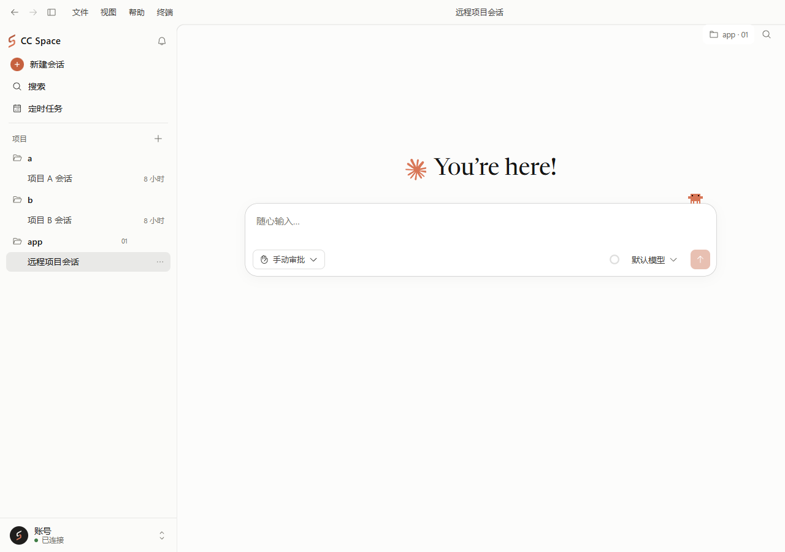
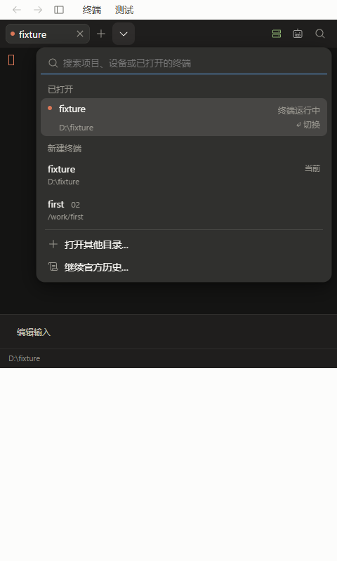
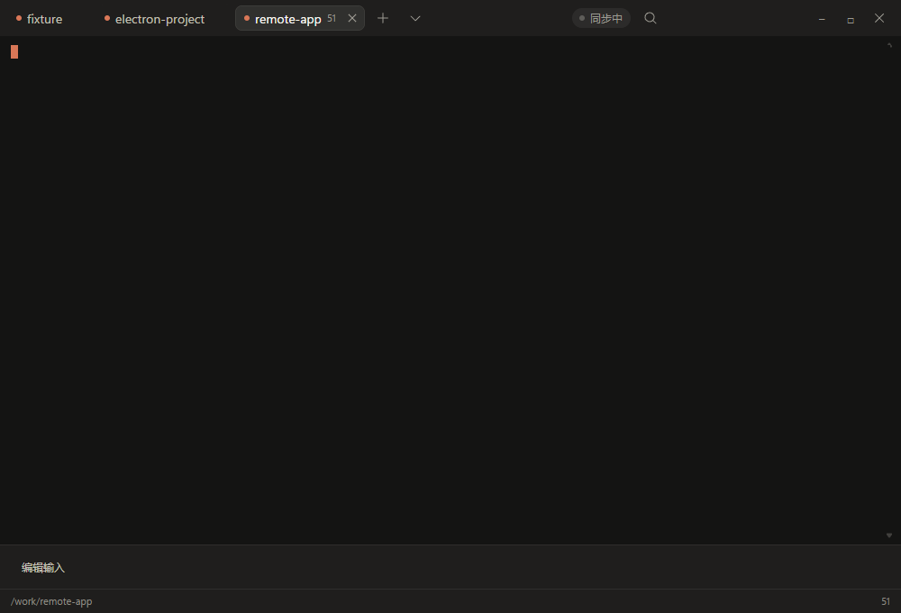
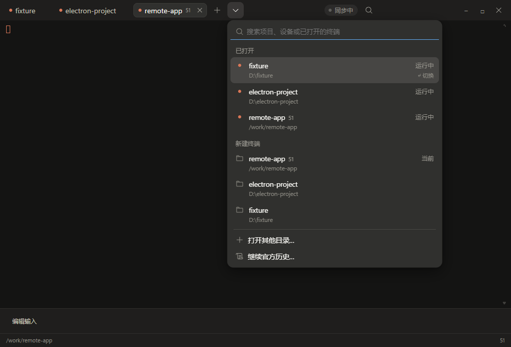

# CC Space 多设备开发：实施与验收

2026-11-06（香港时间）。分支 `codex/multi-device-development`，在 `b12ef04` 上继续修正，保留后续网络边界审查文档提交。按用户提供的《32-multi-device-fix-plan.md》完成桌面端界面与缺陷修复；本次未修改服务端、协议或主进程 SSH 管理器。

## 使用方式

终端标签栏只保留 `＋` 和一个 `▾`。`＋` 在当前标签的设备与项目中新建；`▾` 打开“切换或新建终端”菜单，贴在按钮下方，窄窗口内自动限制位置。菜单平铺“已打开”和“新建终端”两组，支持按项目显示名、设备、完整路径和标签别名搜索。新建项目按当前、最近会话、仅保存路径排序，同设备同目录只有一行；离线项目保留，选中后先连接。悬停显示目录、模型、审批模式与思考强度。

菜单用 ↑ / ↓ 连续选择，两组分别以 Enter 切换或新建；选中行标明结果。Escape 关闭并将焦点还给 ▾，组合输入期间 Enter / Escape 不执行菜单动作。“打开其他目录…”使用现有项目对话框，“继续官方历史…”沿用既有能力协商与确认流程。双击或右键终端标签可以修改别名。

终端窗口支持 Ctrl+Shift+T 新建同项目终端、Ctrl+Shift+Space 开关菜单、Ctrl+Tab / Ctrl+Shift+Tab 循环切换标签；xterm 与标签上的焦点均支持，组合输入时不拦截。已核对 [Claude Code 官方快捷键说明](https://code.claude.com/docs/en/interactive-mode)：保留 Ctrl+T 等不带 Shift 的 Ctrl+字母，未覆盖其已列出的默认操作。自动化组合事件不等同于 Windows 实体中文输入法验收，尚无已确认的 Ctrl+Shift+Space 系统冲突，故本次保留该组合。

主界面侧栏统一展示本机与当前工作空间内管理的 SSH 项目。侧栏、右上角项目标记、终端底栏和菜单只标远程设备短名，本机不加设备标注；多设备标签混用时也只给远程标签加短名。侧栏仍能用“本机”搜索本机项目。移除侧栏顶部的终端提示条，终端入口保留在标题栏以及本窗口所占用会话的聊天状态条。

项目的 ⋯ 菜单增加“新建终端”，有来源时继承同设备同目录最近会话的配置，没有来源时使用新终端默认配置。窗口已开时追加标签，窗口未开时静默创建并打开终端，主界面当前会话不变。顶部“新建会话”和主界面快捷键恢复为本机普通会话；项目行 ＋ / 项目菜单仍创建项目会话，首页“本机 · 普通会话”按钮仍允许主动指定目标。

图形界面与终端可以在不同会话中并行，同会话继续互斥。本窗口终端占用显示“正在终端里运行”并提供“返回终端”；其他窗口或电脑占用显示“此会话正在另一个窗口的终端中使用”，不提供错误的接回按钮。SSH 项目标记悬停只显示实际设备与路径，本机标记说明移动操作。

## 缺陷与边界

- **B1 原生状态互斥**：自动读取与输入框 `/refresh` 都检查任意本窗口活跃/启动中终端及服务端会话终端占用。阻止手动读取时明确提示；最后一个终端结束后，尚未读取的当前会话补读一次。账号页行为与服务端 `readStatus` 未改。
- **B2 开发项目过滤**：菜单与项目终端创建共用 `terminalChoices`。只保留本机普通会话根目录外的会话，以及当前工作空间中可用的托管 SSH 设备会话；排除普通会话、其他电脑与非当前工作空间设备。保存路径参与同设备去重，SSH 同名路径仍按设备隔离。来源优先当前标签，否则按最近更新时间与稳定 ID 选择。
- **B3 审批默认一致**：无来源的新终端统一为 `default`，本机和远程均使用默认模型与思考强度。远程创建后必须等待 `session.configure` 成功再打开终端。配置失败保留会话并在项目对话框中重试，不打开终端；项目菜单静默创建失败也恢复到同一会话的重试流程。
- 项目身份仍由服务范围、设备 ID 与规范目录构成；草稿、阅读位置、别名、置顶、折叠与通知沿用已有机制。迟到的创建结果不会改变主窗口选择；网络连接变化使旧对话框失效。
- 模型 SDK / CLI 继续在既有 Ubuntu 服务进程执行，桌面仅承担界面和 SSH 转发，开发文件与命令在所选设备执行。未改认证、审核钩子、模型出口、代理、官方 CLI / SDK 或品牌素材。部署级授权与实际公网出口的既有限制见 [网络及 Claude 边界审查](MULTI-DEVICE-NETWORK-CLAUDE-REVIEW-2026-11-06.md)。

## 验收对应

| 要求 | 验证 |
| --- | --- |
| 单一 ▾、锚点、两组、菜单动作 | `terminal-projects.spec.ts`、`terminal-preview-chrome.spec.ts`、真实 Electron 菜单 |
| 键盘、组合输入、别名 | 终端专项与跨文档窗口用例 |
| 只标远程、浅深色与窄窗口 | 侧栏、主界面、终端专项与证据截图 |
| 项目 ⋯ 静默新建终端 | 本机 / 远程首次打开与已有窗口追加用例 |
| 顶部新建始终本机普通会话 | 远程选择下的按钮与 Ctrl+N 用例，首页主动选择目标回归 |
| 移除侧栏提示、区分窗口归属 | 侧栏回归与其他窗口占用用例 |
| B1 任意终端状态互斥 | A 终端 / B 未读取状态、手动刷新拦截、结束后仅补读一次 |
| B2 项目过滤与来源 | `development-projects.test.ts`：普通会话、其他电脑、不可用 SSH、去重、双设备同路径与来源排序 |
| B3 配置先于终端 | 无来源默认、来源继承、配置失败不打开、同一会话重试用例 |
| 原有聊天、布局、动效、SSH 与终端 | 原 125 项回归及原 43 项多设备用例按批准语义更新后重跑，包含新增场景 |
| 类型、构建、格式与网络边界 | TypeScript、renderer production build、Prettier、模型依赖/导入边界与相关核心测试 |

最新复查结果见 [追加独立复查](MULTI-DEVICE-FOLLOWUP-REVIEW-2026-11-06.md) 及其 [验收记录](evidence/multi-device-followup-review-verification.json)。`2fa600d` 的 [修正验收记录](evidence/multi-device-fix-verification.json) 保留为历史批次。[原实施记录](evidence/multi-device-development-verification.json) 保留 `b12ef04` 时的测试与真实双 Linux 联调历史，不作为本次 renderer 的最新摘要。

## 本轮审查落实

按规格审查、代码质量审查和实际渲染检查，补齐以下细节，并用失败复现与修复后用例验证：

- 项目菜单静默创建后的配置失败恢复到对话框，本机保留创建身份，远程保留已打开的会话；重试不重复创建。丢响应、重复配置失败及取消后重试均保留第一次请求的审批模式、模型与思考强度，成功后再清理创建身份和快照。
- 新建项目禁用时，Enter 与点击使用同一可用性检查；菜单底部动作的 Enter 不再被选中行截获。
- Tab 移到另一行时同步高亮与执行目标；中文组合输入期间不触发菜单或窗口快捷键。组合输入未结束就关闭菜单时也会清理状态，后续键盘动作可继续使用。标签改名始终保存原目标 ID，切换或新建标签后不会改错标签。
- 窄窗口保留本机路径和远程短名，不再沿用隐藏最后一个底栏元素的旧样式；菜单保持打开时缩放窗口，也会在所属窗口重新定位。
- 已打开终端的状态文字位于行右侧，项目别名和设备名均可搜索；本机设备名可用于搜索，但不显示设备标签。含空格路径的项目选项使用合法的无障碍定位 ID。
- 原有“本机”标签、分段按钮和选择器弹窗相关测试按批准语义更新；原生状态回归恢复节点级终端互斥，真实 Electron 测试保留冻结的桥接对象。

## 本次验证结果

- 追加独立复查确认并修复 3 处问题，9 个新增用例均完成失败复现与修复后验证。
- 最新完整界面回归 **200/200 通过**，零失败、零跳过：原回归 125、多设备专项 72、额外终端外观回归 3，包含前次 191 项及本次新增 9 项，不重复累加。
- 相关核心及网络边界测试 **72/72 通过**，零失败、零跳过；TypeScript、前端生产构建、格式检查、模型依赖与导入边界检查通过。
- 两位独立审查者复核修复后未发现剩余的已确认问题。本次行为修复未调整布局与样式，浅深色截图沿用前次提交的界面证据。

## 界面证据

以下为隔离测试数据的真实渲染结果。每种截图另有 `-dark.png` 深色版本；终端内部沿用既有深色配色，应用主题与主界面分别核对。

## 实机与交付范围

原实施的双 Alpine Linux 设备联调 9/9 通过，包含真实 SSH / SFTP / Bash / GCC，使用受控 SDK 生产者，未执行真实 Claude 推理。此次仅改桌面 renderer 与测试，未重新宣称验收生产 Ubuntu、真实 Claude 账号、实体输入法或安装包。

本次保留现有分支，追加提交；不推送、不合并、不生成安装器、不签名、不发布或部署。原 `ui/motion` 主工作区未提交内容不动。

原全量 Node 批次存在 `.dockerignore` 遗漏 `deploy/host-update/cleanup.py` 的已复现基线失败，以及单独复测已通过的 Windows 临时目录清理 EPERM；不将原完整批次描述为全绿。本次按修复范围执行相关核心与界面回归。

历史失败测试目录 `C:/Users/benben/AppData/Local/Temp/cc-managed-client-tibXK2` 的清理曾被自动审批拒绝，仅返回 `blocked by policy`；该目录保留，未绕过限制。
