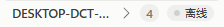
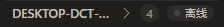

# 侧栏项目移除与设备状态修复

2026-11-06（香港时间）。基于 `c1ae2fd`，开发分支 `codex/sidebar-project-actions`。

按用户要求参考当前 Codex 桌面项目菜单。实际只读查看确认其将“移除项目”和“归档聊天”作为独立操作，本轮没有在 Codex 中移除或归档真实项目。

## 行为

- 本机和当前工作空间托管 SSH 项目的 ⋯ / 右键菜单新增“移除项目”，确认后只移除侧栏分组。
- 会话、草稿、项目路径及磁盘文件保留；普通会话显示在“最近”，置顶会话保持置顶。所选会话不跳转，运行中的任务不受影响。
- 移除标记保存在本机偏好中，重启后仍有效；本机路径及远程服务/设备/路径使用现有身份规则，不会误隐藏另一设备的同名目录。
- 通过“打开项目”重新添加目录可恢复分组；兼容原生选择器、旧版添加对话框、接管目录及更改项目文件夹。已有显示名保留，移除时清理项目自身的置顶和折叠状态（包含旧版 SSH 项目标记）；设备整体及其他项目的折叠偏好保留。
- 移除后的本机与远程会话合并按最近更新时间排列，不按设备顺序追加。
- “其他设备”在线/离线徽标不再被压窄换行；折叠后仍显示完整单行状态和数量，长设备名优先省略。

## 487494e 追加复查

两路独立只读审查发现一处 P3 兼容遗漏：旧版 SSH 项目级 `collapsedElsewhere` 标记未随移除清理，重新打开后仍折叠。现在只清理该设备和目录对应的旧标记，保留设备整体和其他项目的折叠偏好，不影响会话或文件。

项目级标记的用例先复现失败，设备级标记保留的控制用例原本通过；修复后的两个变体均通过。复查批次 **91/91**、修复后相关组 **51/51**，去重覆盖 **93 个不同 UI 用例**；核心 **12/12**、类型、构建、格式和模型边界检查通过。独立复核未发现剩余已确认问题，结果追加到 [验收 JSON](evidence/sidebar-project-actions-verification.json) 的 `review487494e`，此前结果保留为历史记录。

## 首次实施验证

初始缺少移除入口和折叠徽标换行的 3 个用例先失败、修复后通过。审查补充的旧入口恢复、已移除目标目录的更改文件夹恢复及跨设备最近顺序也均先复现再修复。

- 首批相关 UI **89/89** 通过；最后补齐目录恢复与最近排序后相关组 **75/75**，确认文案收尾后目标组 **6/6** 通过。
- 按文件和测试标题去重，覆盖 **91 个不同 UI 用例**，包括本机/远程/空项目移除、取消、会话保留、重新打开、持久化、同路径隔离、置顶保留、浅深色和窄侧栏。
- 相关核心及模型边界 **12/12**、类型、生产构建、Prettier 和 diff 检查通过。独立审查无待修复项。

[机器可读验收记录](evidence/sidebar-project-actions-verification.json) 保留批次范围、源码摘要和失败复现日志，历史重叠测试不重复累加。

## 排版证据

以下是 240px 侧栏的实际渲染设备行，保留原像素，仅裁去无关区域。

## 范围

仅改桌面 renderer 与本机偏好，不新增删除会话/目录请求，不修改服务端、协议、SSH 主进程、依赖或认证。未访问或删除用户的真实项目，会话数据与项目文件均未动；未打包、推送、合并主分支或发布。
