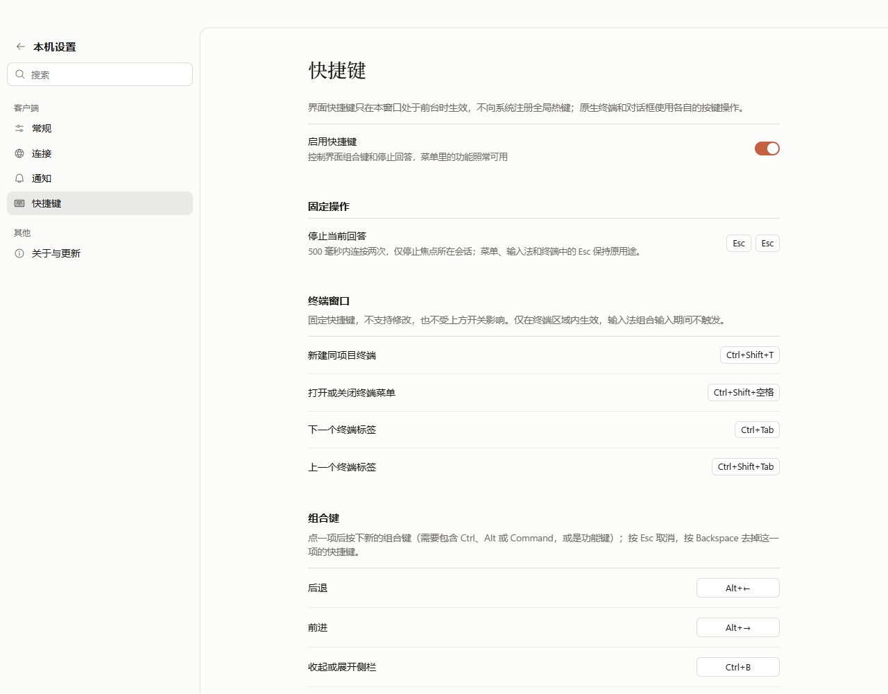
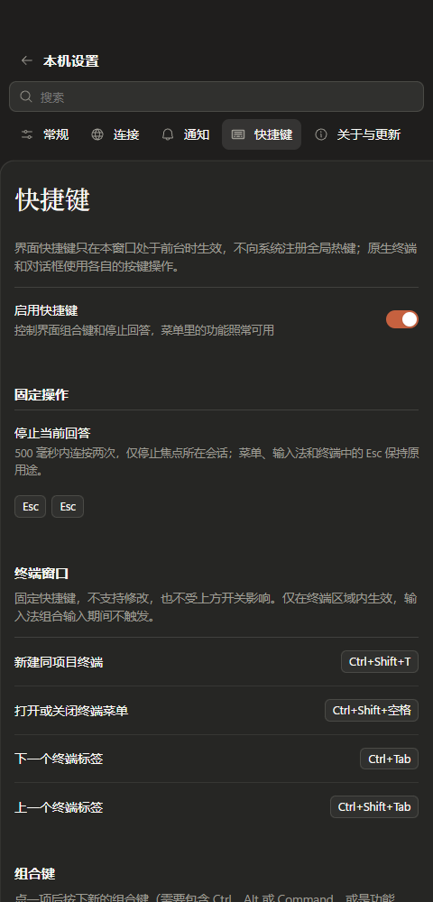

# 终端快捷键设置说明

2026-11-06（香港时间），分支 `codex/terminal-shortcuts-settings`，基于 `b0680ae`。

## 界面

桌面客户端“设置 → 快捷键”新增“终端窗口”分组，位于固定操作与可修改组合键之间。沿用现有标题、说明文字、卡片行、分隔线和键帽，未添加样式、颜色、图标或新的编辑控件。

| 操作 | 固定快捷键 |
| --- | --- |
| 新建同项目终端 | Ctrl+Shift+T |
| 打开或关闭终端菜单 | Ctrl+Shift+空格 |
| 下一个终端标签 | Ctrl+Tab |
| 上一个终端标签 | Ctrl+Shift+Tab |

分组注明固定绑定、不支持修改、不受界面快捷键开关影响，以及终端区域和输入法组合输入的生效范围。原开关说明改为明确控制界面组合键和停止回答，避免承诺关闭本页所有操作。网页客户端不显示桌面终端分组。设置分类搜索增加终端、标签、菜单、空格等词。

本次仅展示已有功能，没有更改终端绑定、可配置动作、开关行为或任何服务端逻辑。

## 验证

- 直接相关的设置、布局、按钮、停止快捷键与终端用例 **64/64** 通过；模型依赖与导入边界 **6/6**、类型、生产构建、格式及独立只读审查通过。
- 实际设置页面预览确认 4 行固定说明、0 个修改控件；关闭界面快捷键时原编辑按钮禁用，终端说明仍可见。
- 浅深色及 1280/480/320px 均无分组横向溢出，页面无错误；搜索“标签”能定位快捷键设置。
- 扩大到 91 项的批次为 89 通过、2 失败：一项仍期待关于页已不存在的项目主页按钮，另一项设置分类旧预期漏列现有“连接”。这些界面和断言未在本次修改，不把扩大批次描述为全绿。

[机器可读记录](evidence/terminal-shortcut-settings-verification.json) 保存准确批次、失败位置、预览范围和源码摘要。预览通过临时桌面能力门面检查真实组件渲染，没有连接生产服务。

## 实际界面

## 范围

生产代码仅修改 `ShortcutSettings.tsx` 和 `SettingsPage.tsx`，复用已有 CSS。未推送、打包、发布或部署；两项既有旧测试预期保持原样。
