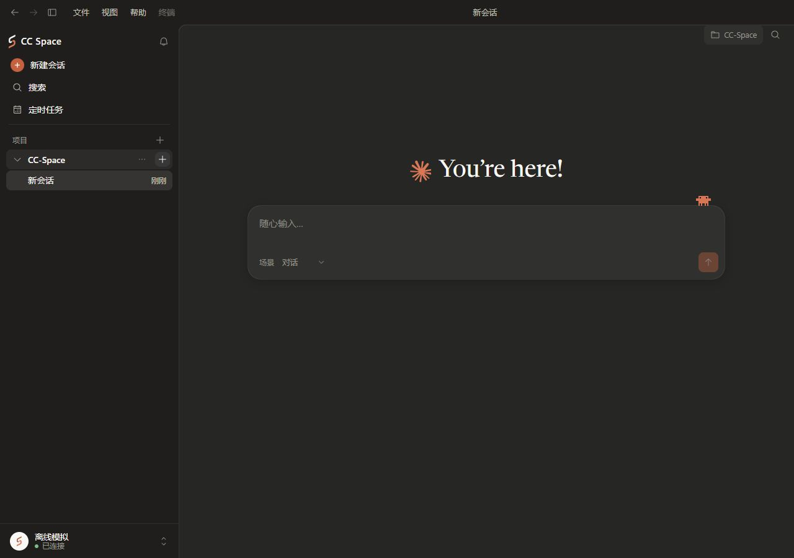
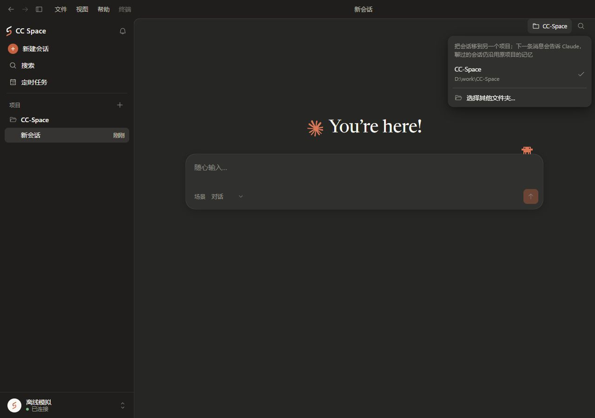

# CC Space 多设备开发：导航方案复核

日期：2026-11-05（香港时间）
基线：主分支 f631a61c3e195151bb0e5212dc37d8b3aed9b38c。
状态：讨论候选；没有修改产品源码或决定实施。

## 保留的候选 A

前一轮建议的“全局项目切换器＋项目内会话＋跨项目任务提示”保留。它适合长期专注单一项目，但切换会隐藏其他项目，且增加全局上下文及后台任务聚合的理解成本。当前尚无证据需要增加这些界面层级。

## 取证范围与限制

本轮采用 Product Design audit 的界面与源码核对方式。主界面截图来自主分支源码的独立本地模拟环境，数据为人为添加的示例项目；未连接真实 SSH、调用模型或改变已安装应用。终端入口依据用户本轮提供的截图与同一提交的源码。未完成真实设备端到端测试，也未作完整可访问性验收。

1. 主界面项目列表：层级清晰，现有项目行与会话行可复用。界面为 288px 默认侧栏、顶部菜单、宽松聊天区域。
   
2. 聊天右上角项目菜单：已确认实际执行的是移动当前会话，不是导航到其他项目，语义需要与日常切换保持区别。
   
3. 终端“全部终端→选项目新建”：入口存在，已有项目来自拥有设备的已有会话，具备跨设备选择基础；位置混合了打开中的标签列表与新建动作。尚不能据此认为没有历史会话的设备及目录都能直接使用。
4. 主窗口与终端并行：源码中 Sidebar 的会话选择/新建、App 的输入框及导航受 terminalsActive 限制。跨项目并行不能只修改视觉入口；需评估并解除窗口级锁定，同时保留同一会话在聊天与原生终端之间的互斥。

## 更推荐的候选 B：在现有布局中统一入口与归属

### 终端

- 保留“＋”的一步新建同项目行为，悬停说明目标设备和项目。
- 将选择其他设备/项目的新建动作放在“＋”旁的小箭头中；已有的“全部终端”用于查找和切换打开中的标签，不再承担主要新建入口。
- 选择器按“设备＋目录”合并同一项目的多个会话，明确以哪个会话配置作为新终端来源（如最近使用的来源）；不要悄悄改变沿用模型、权限和历史的语义。
- 最近项目直接一击选择；其他项目按设备分组。无历史会话的远程目录使用已有 SSH 目录验证/项目创建入口。
- 标签以项目名为主、设备短名为次。单设备窗口减少重复信息；多设备时设备归属常显。完整地址和路径放悬停说明与底部现有状态位置。

### 图形界面

- 继续用现有侧栏查看多个项目，不新增常驻服务器栏或全局项目切换状态。
- 让本机与本机配置的 SSH 项目使用同一项目列表和项目内新建入口，远程项目显示低对比度但可读的设备短名；未知或不可操作的其他设备历史可以继续保留在原分组。
- “项目＋”扩展为打开项目入口：选择本机目录或已配置 SSH 设备的目录，复用现有连接、认证和路径验证。
- 有项目的“新建会话”明确继承当前会话的设备和项目；项目行的“＋”始终使用该行目标。首页无上下文时保留普通会话选择，显示将使用的位置，不静默回退到第一台服务器。
- 现有右上角项目标记补充设备归属。其原有“移动会话”能力以明确名称保留；不要把该按钮直接伪装成项目切换器。
- 复用项目行/会话行的活动提示、折叠项目的状态汇总和通知铃铛，不先增加独立任务中心。

### 并行语义

- 终端 A 打开时，主窗口可以查看或运行 B 项目的独立会话。
- A 的原生终端控制 A 会话时，A 图形聊天显示“终端运行中/返回终端”，不得同时向同一会话启动另一条模型执行。
- 导航、关闭标签、断开设备、移动会话是不同动作；切换视图不得终止任务或换执行目标。
- 设备离线影响它的项目；不回退本机或其他设备。恢复连接不等于已成功恢复原命令，沿用既有恢复边界。
- 各会话草稿、滚动位置与项目展开状态分别保留，打开终端不会因主界面导航而被销毁。

## 审美约束

沿用当前暖灰/炭黑底色、既有字体、图标、圆角、菜单及间距。项目名称保持视觉主体；设备说明作为次要文字，不使用每台设备一个彩色胶囊。状态颜色只提示真实运行/等待/异常，不用颜色代替文字识别。详细地址、完整路径、管理操作按需展开。窄窗口延用现有侧栏折叠，不堆叠新工具栏。项目操作在悬停及键盘聚焦时可见，设备归属不能只靠悬停或颜色识别。

## 建议次序

先明确“新建入口、设备归属、窗口并行”三件事，再用现有界面的少量局部设计图比较。只有项目数量和实际使用反馈证明需要时，再考虑全局过滤器、独立设备侧栏或任务中心。
