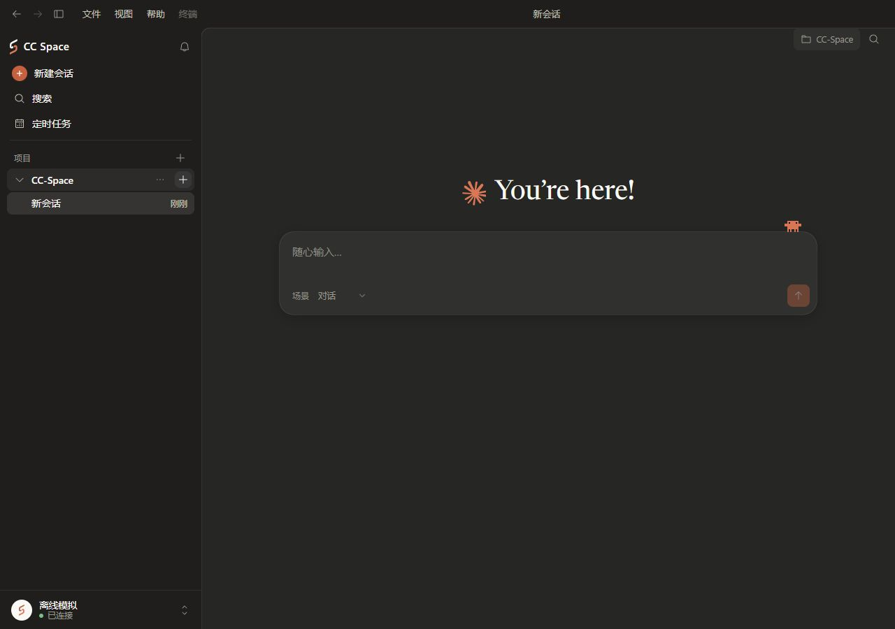
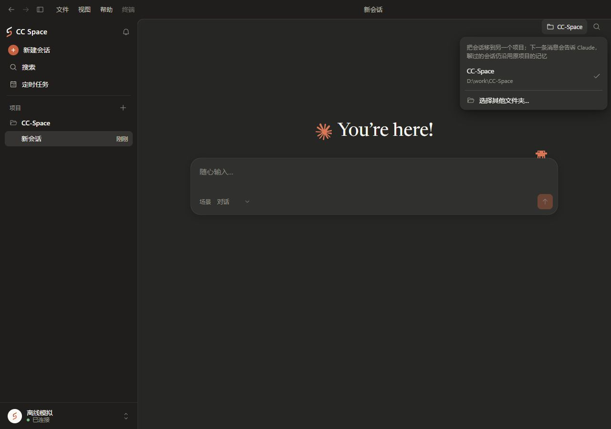

# CC Space 多设备开发体验优化方案

- 日期：2026 年 11 月 5 日（香港时间）
- 版本：讨论稿 v1.0
- 核对基线：主分支 `f631a61c3e195151bb0e5212dc37d8b3aed9b38c`
- 适用范围：本机与多台已配置 SSH 设备上的项目、图形聊天和原生终端
- 文档状态：用户已批准实施；原始方案日期为 11 月 5 日，实施验收见 [实施记录](../../MULTI-DEVICE-DEVELOPMENT.md)

## 1. 建议采用的方向

以现有界面为基础，完成三项优化：**让跨设备新建容易找到，让项目的设备归属清楚，让不同会话可以在图形界面和终端之间并行工作。**

保留现有的侧栏、项目分组、聊天区域与独立终端窗口。日常围绕项目开展工作，设备作为项目的明确属性出现。用户可以同时看到本机、01、02 的项目，直接进入相应会话。

前一轮提出的“全局项目切换器＋项目内会话＋跨项目任务提示”作为候选方案保留。本轮优先推荐局部改进，待实际项目规模和使用反馈证明有需要，再考虑增加全局筛选或独立任务视图。

## 2. 要解决的使用场景

用户先打开 `01 · 后端服务` 的终端，接着需要在本机修改网站前端，同时让 `02 · 数据处理` 继续执行任务。

优化后的预期流程：

1. 在 01 的终端点击 `＋`，一步新开同项目终端。
2. 点击 `＋` 旁的新建菜单，选择 `02 · 数据处理`，在同一个终端窗口新增标签。
3. 回到主界面，从侧栏直接选择本机的网站前端会话，继续聊天和开发。
4. 01 或 02 等待用户处理时，侧栏现有状态提示和通知入口提供定位。
5. 返回任何会话或标签时，保留其草稿、阅读位置和运行状态。

这里的“本机、01、02”表示项目文件及开发命令的执行设备。Claude 仍按现有架构运行在既有 Ubuntu 服务端。服务连接与开发设备在界面上使用不同名称，避免把 SSH 设备选择理解成切换 Claude 服务或账号。

## 3. 当前能力与问题

| 位置 | 已有能力 | 本轮需要改善的地方 |
| --- | --- | --- |
| 终端 `＋` | 沿用当前会话所属设备及项目新建终端 | 按钮没有充分说明默认目标，跨项目入口离它较远 |
| 终端“全部终端”菜单 | 已有“选项目新建”、标签搜索、别名和继续历史 | 新建动作藏在标签管理菜单中，首次使用不易发现 |
| “选项目新建” | 可以从拥有设备信息的已有会话选择项目 | 列表实际按会话提供选项，需要按设备与目录合并；首次远程目录还要有入口 |
| 主侧栏 | 本机项目、会话及“其他设备→设备→项目→会话” | 本机与 SSH 项目操作不对称，远程项目层级更深 |
| 设置→连接 | SSH 配置、连接恢复、远程目录选择及打开项目 | 高频的打开项目操作需要进入设置 |
| 聊天右上角项目菜单 | 移动当前会话到另一个项目 | 容易被理解为浏览切换，必须明确区分 |
| 主界面与终端 | 独立终端、多标签及已有状态反馈 | 终端活动期间存在窗口级导航、新建和输入限制，妨碍不同会话并行 |

上述判断来自本轮主分支源码、主界面的独立模拟预览，以及用户提供的终端截图。已有跨设备选择入口不等于所有新设备、新目录和并行场景都已完成实机验收。

## 4. 方案比较与选择

| 方案 | 适用情形 | 主要取舍 | 建议 |
| --- | --- | --- | --- |
| 改进现有侧栏与终端入口 | 经常交替处理本机和数台服务器上的项目 | 需要统一项目归属和会话生命周期，外观调整较小 | 本轮采用 |
| 全局项目切换器 | 长时间专注一个项目，其他项目较少同时关注 | 切换后其他项目不再直接可见，需要额外的跨项目状态入口 | 保留候选 |
| 每台设备独立窗口 | 长期使用多屏、设备之间职责分明 | 窗口增加，跨设备查看和寻找会话成本上升 | 以后按需求补充 |

## 5. 终端优化

### 5.1 新建入口

把新建设计为一个紧凑的分段按钮，沿用现有图标和尺寸：

| 操作 | 行为 | 提示文案示例 |
| --- | --- | --- |
| 点击 `＋` | 在当前设备、当前项目创建一个新会话并打开终端标签 | 在 01 · 后端服务中新建终端 |
| 点击紧邻 `＋` 的小箭头 | 打开“新建终端”选择菜单 | 选择设备或项目新建 |
| 打开“全部终端” | 搜索、定位已经打开的标签 | 搜索项目、设备或标签 |

两个相邻入口有明确边界和各自提示，避免把新的小箭头误认成“全部终端”。全部终端入口与新建按钮组留出既有控件间距；键盘聚焦时分别朗读用途。

现有“选项目新建”作为过渡入口保留一个版本，打开同一个选择器，避免熟悉旧位置的用户失去入口。该版本之后评估是否移除重复入口。

### 5.2 选择器内容

选择器按顺序提供：当前项目、最近使用的项目、其他已保存项目、打开其他项目。最近列表最多显示五项，其余通过搜索和设备分组查找。

每个项目显示项目名和设备名；完整目录按需展开。搜索匹配项目名称、设备名称及目录。一个项目的多个聊天会话不会重复占据项目列表。

项目身份由“当前服务范围＋稳定设备 ID＋规范目录”共同确定。01 与 02 上相同的 `/work/app` 是两个项目；本机同名目录也单独识别。设备改名不会改变项目身份。

- 已连接设备：可以选择项目并创建。
- 已保存但离线的设备：项目仍可见，选择后进入既有连接流程，成功后再创建。
- 首次使用的远程目录：选择 SSH 设备，再用已有远程目录选择与验证流程。
- 从本机进入：调用现有本机目录选择器。
- 取消选择或连接失败：留在原标签，不创建空白标签或多余会话。

### 5.3 新建、继续历史与配置来源

“新建终端”创建新的会话；“继续官方历史”沿用现有独立入口。选择某个项目不会自动恢复其历史对话。

同项目 `＋` 继续使用当前来源会话的模型、权限和思考强度。跨项目选择器去重后，来源按以下顺序确定：当前活动标签属于该项目时使用该来源，否则使用该设备和项目中最近更新的会话；时间相同时以稳定会话 ID 确定顺序。选择器的项目详情提供将沿用的配置说明。

没有来源会话的新项目使用现有新会话默认配置；不要为了得到一个来源，连续制造两个空会话。远程项目首次创建通过该设备已有后台连接完成，再打开同一新会话的终端。创建响应丢失时沿用现有幂等确认机制，避免重复创建。

### 5.4 标签与设备归属

标签标题以项目名称或用户别名为主，设备短名作为次要文字。窗口内只有一台设备时，在现有底部状态位置清楚显示设备；出现多设备标签后，各标签常显设备短名。

完整设备名、目录和别名放入悬停提示及可访问名称。截断优先压缩过长的项目名称，不能把识别设备所需的信息全部挤掉。标签别名不能覆盖设备身份。

正常连接状态保持安静；等待确认、恢复连接及失败沿用当前状态图标和提示。颜色只辅助说明状态。

## 6. 图形界面优化

### 6.1 保留侧栏结构，统一可操作项目

在现有“项目”区域中，统一展示本机项目与本机配置的 SSH 项目。项目下继续展开会话，不增加常驻设备导航列。

| 项目行主体 | 次要信息 | 项目行操作 |
| --- | --- | --- |
| 网站前端 | 本机 | 展开会话、新建会话、项目菜单 |
| 后端服务 | 01 | 展开会话、新建会话、项目菜单 |
| 数据处理 | 02 | 展开会话、新建会话、项目菜单 |

用户现有置顶、项目排序、项目别名和折叠习惯继续适用。初次迁移时保留本机项目原有顺序，将已配置 SSH 项目加入其后；后续允许用户通过既有置顶机制安排常用项目。不会因切换会话或收到新输出而自动重排项目。

同一设备与目录只对应一个项目组。未知设备、其他电脑的历史，以及当前无法通过本机 SSH 配置操作的设备，继续放在“其他设备”中。已纳入项目区域的同一组会话不再在其他设备中重复显示。

只保存了远程项目、尚无会话时，仍显示项目行，并提供新建入口。离线项目也保留；连接失败不能让它从列表中消失。

### 6.2 打开项目与新建会话

侧栏“项目”旁的 `＋` 使用“打开项目”名称。点击后可选择本机目录、已配置 SSH 设备上的目录，或添加 SSH 设备。地址和认证表单复用设置→连接的现有能力；日常无需绕到设置页。

新建规则统一如下：

| 入口 | 目标规则 |
| --- | --- |
| 项目行上的 `＋` | 始终在该行的设备与目录创建 |
| 查看一个项目会话时点击“新建会话” | 继承当前会话的设备与目录 |
| 首页、设置或没有项目上下文时新建 | 在新建区域明确显示目标，可选择普通本机会话或已保存项目 |
| 目标离线时新建 | 先连接该目标；失败保留选择和输入，不切换目标 |

新建动作完成前可以确认其目标；不能因为选择器缺少远程来源而默认落到本机项目。

### 6.3 保留现有聊天画布

聊天区域保持当前留白、消息宽度、输入框和工具位置。右上角现有项目标记补充设备，例如“后端服务 · 01”，详细地址和目录按需显示。

点击该标记打开项目详情与操作菜单，明确写出“移动当前会话到其他项目…”；移动功能继续遵守现有设备能力及运行状态限制。日常查看其他项目通过侧栏和搜索完成。

导航到其他会话、在同一项目新建、移动已有会话是三种独立操作。项目选择器不能在用户仅浏览时发送移动命令。

### 6.4 状态提示与搜索

复用现有会话运行状态、折叠项目状态汇总和通知铃铛。项目收起时仍可看见需要用户处理的状态；收到提示后可直接定位相应会话。

将现有搜索扩展为同时匹配设备名、项目名、会话名及目录。搜索结果显示项目与设备归属，使两个同名项目容易区分。沿用现有搜索快捷键，不为这次优化再新增一套命令面板。

用户主动查看其他项目时，不自动切回新完成的任务，也不抢夺正在输入的焦点。

## 7. 图形界面与终端并行规则

这是本轮的功能重点。主窗口是否允许操作，应依据当前会话的实际占用状态判断。

| 情况 | 应有行为 |
| --- | --- |
| 01 项目会话 A 的终端在运行，用户查看本机会话 B | 允许正常查看、输入并独立运行 B |
| 两个不同会话位于同一项目 | 允许分别运行；沿用已有同目录并行修改提醒，不自动生成 worktree |
| A 由原生终端控制，用户在图形界面打开 A | 展示已有内容及“终端使用中／返回终端”，保留草稿；禁止同时启动 A 的第二条模型执行 |
| 用户从图形界面打开已有终端的会话 | 聚焦对应标签，避免重复创建 |
| 用户打开另一个可启动终端的会话 | 在现有终端窗口增加该会话对应的标签 |
| A 正在以图形模式运行，用户尝试为 A 打开终端 | 沿用现有运行互斥提示，不能因为终端窗口已经存在就绕过检查 |
| 02 连接暂时丢失 | 02 的会话显示恢复状态，本机及 01 的独立会话继续使用 |
| 原终端是否已结束尚不确定 | 保留占用与恢复提示，不仅根据“断线”就释放同会话互斥 |

技术实现需要将终端窗口生命周期与主界面当前选中会话分开。主界面导航不能卸载其他正在运行的终端、清空其句柄或把关闭请求发给新选中的会话。

同会话的重复执行检查必须覆盖图形发送、菜单打开终端、已有终端窗口追加标签、快捷键及重连路径，并保留服务端已有的最终校验。不能仅删除 `terminalsActive` 条件后视为完成。

关闭一个标签、关闭终端窗口、断开 SSH 设备、退出整个服务连接分别沿用对应的确认和清理边界。切换视图本身不触发上述动作。独立任务在应用退出或执行通道故障后的存续仍受现有架构约束，本方案不承诺永久后台托管。

## 8. 视觉与操作细节

| 项目 | 约束 |
| --- | --- |
| 整体风格 | 沿用现有暖灰/炭黑底色、强调色、字体、图标、圆角、菜单和动效 |
| 侧栏 | 保留当前默认宽度和可调整范围；新增信息使用项目行内的次要文字 |
| 信息层级 | 项目名称优先；设备短名其次；完整地址、认证信息和路径按需展开 |
| 设备识别 | 使用稳定文字标记；不为每台设备增加不同的高饱和色块 |
| 状态 | 正常时简洁，只有运行、等待处理、恢复或错误才出现对应反馈 |
| 操作显示 | 项目行操作沿用悬停显示，并在键盘聚焦时可见；设备归属不依赖悬停 |
| 窄窗口 | 沿用现有侧栏折叠；菜单限制高度并内部滚动，避免增加第二排常驻工具栏 |
| 键盘 | 菜单支持方向键、Enter 和 Escape；关闭后恢复到触发按钮；不抢占终端 CLI 的输入快捷键 |
| 中文输入 | 搜索与选择器在输入法组合期间不误提交、不误关闭 |
| 重复名称 | 通过设备和必要的目录尾部区分，完整名称保持可访问 |

本轮的界面变化应集中在三个局部：终端新建按钮组及选择器、侧栏项目行及打开项目菜单、聊天右上角项目标记及明确命名的操作菜单。

## 9. 实施范围与顺序

### 阶段一：确定规则并准备局部界面稿

将新建、继续历史、导航和移动会话的语义固定下来；用现有组件制作上述三个位置的局部界面稿，比较单设备、多设备、同名项目和窄窗口状态。此阶段完成视觉与交互评审，再进入代码实施。

### 阶段二：让已有跨设备能力容易找到

完成终端新建入口、项目列表去重、设备归属、搜索匹配和新目录入口。连接、认证、远程目录验证及创建请求复用当前实现。

### 阶段三：统一图形项目入口并完善并行

让本机与已配置 SSH 项目共享侧栏操作；统一新建目标规则、项目状态和通知定位。同时完成按会话判断互斥与终端窗口生命周期调整，覆盖已存在窗口时的追加路径。

阶段二可以作为独立的终端体验改进交付，但只有阶段三完成后，才将本轮整体描述为“支持图形界面与终端跨项目并行”。

### 阶段四：验证与试用

先运行隔离测试及界面验证，再通过本机、01、02 的真实组合验收。达到下节标准后，再按现有流程制作新制品和发布。源码、模拟验证、真实设备验证及已发布状态分别记录。

### 本轮范围之外

普通 SSH Shell、远程文件编辑器、跨设备文件同步、设备代理部署、跨项目共享聊天上下文、自动创建 worktree、全局任务中心，以及多窗口布局管理均留作独立需求。现有远程附件、Git、文件预览等能力限制仍需在相应入口清楚表达。

## 10. 验收标准

以下均为未来实施的验收要求，不是本次已经通过的测试结果。

| 编号 | 场景 | 通过标准 |
| --- | --- | --- |
| A1 | 当前项目新终端 | 点击一次 `＋` 即开始创建；设备、目录和配置来源符合当前标签 |
| A2 | 切换到最近项目新终端 | 打开新建菜单后选项目即可创建；不需要进入设置页 |
| A3 | 同名目录跨设备 | 本机、01、02 的同名项目分别显示，创建和文件/命令路由不串设备 |
| A4 | 一个项目多个会话 | 项目选择器只出现一个项目项，来源配置明确且结果稳定 |
| A5 | 没有历史的新远程目录 | 验证目录后只建立所需会话和终端，不遗留重复空会话 |
| A6 | 在远程项目新建图形会话 | 顶部新建与项目行新建都进入正确目标，不默认落到本机 |
| A7 | 图形与终端并行 | A 终端运行时可以操作独立 B 会话，A 不退出、不重启、不重复发送输入 |
| A8 | 同会话互斥 | 图形发送、已有窗口追加标签、菜单及快捷键均不能绕过占用检查 |
| A9 | 导航与移动 | 查看其他项目不发送会话移动命令；移动入口名称明确 |
| A10 | 断线与恢复 | 只限制受影响目标；未知终端状态不会被当作已结束；不自动重放输入 |
| A11 | 多任务状态 | 折叠项目仍能发现等待确认/回答的会话，通知能正确定位，且不抢焦点 |
| A12 | 保留个人状态 | 切换后草稿、阅读位置、项目别名、置顶和折叠状态正确保留 |
| A13 | 视觉检查 | 浅色、深色及 1280/1000/800/480px 窗口中，标签、设备名和菜单可读、可操作，无遮挡 |
| A14 | 输入与无障碍 | 键盘可完成选择和返回；焦点清楚；设备识别不依赖颜色；中文组合输入不误触 |
| A15 | 生命周期 | 取消、创建结果未知、关闭标签、关闭窗口及切换会话的迟到回复均只作用于原目标 |

验证分层：项目身份与创建路由检查、会话互斥与生命周期测试、图形及真实 Electron 交互验证、两台真实 SSH 目标的联调。真实模型调用与生产验证按届时授权及现有项目规则执行，模拟结果不代替生产验收。

## 11. 风险与控制重点

最大的实现风险是把当前窗口级限制直接移除，造成同一会话双重执行、终端随导航卸载或迟到事件落到错误目标。应先明确会话占用与窗口归属，再调整按钮可用性。

其次是把远程项目合入本机列表时沿用仅按目录识别的旧键。项目别名、置顶、折叠、草稿归属和目录操作都应核对设备身份；保留对原本机数据的兼容读取。

第三是把视觉上的“选择项目”误接到当前会话的移动接口。导航、新建和移动的事件入口、文案和验证必须分别对应实际行为。

这些事项应作为实施和评审重点，不通过额外弹窗或长期占据画布的说明栏转嫁给用户。

## 12. 参考与当前界面

- [上一轮方案复核与候选比较](../../evidence/multi-device/navigation-review.md)
- 相关源码：`Sidebar.tsx`、`App.tsx`、`TerminalWindow.tsx`、`NativeTerminal.tsx`、`SshConnectionsSettings.tsx`、`ssh-targets.mjs` 及现有服务端会话/终端创建路径。
- 实施时应重新核对主分支及相关能力，避免覆盖本地尚未提交的工作。

以下为本轮核对时从主分支运行的模拟界面，用于说明现有布局，不是优化后的效果图。

### 当前主界面

### 当前项目菜单

